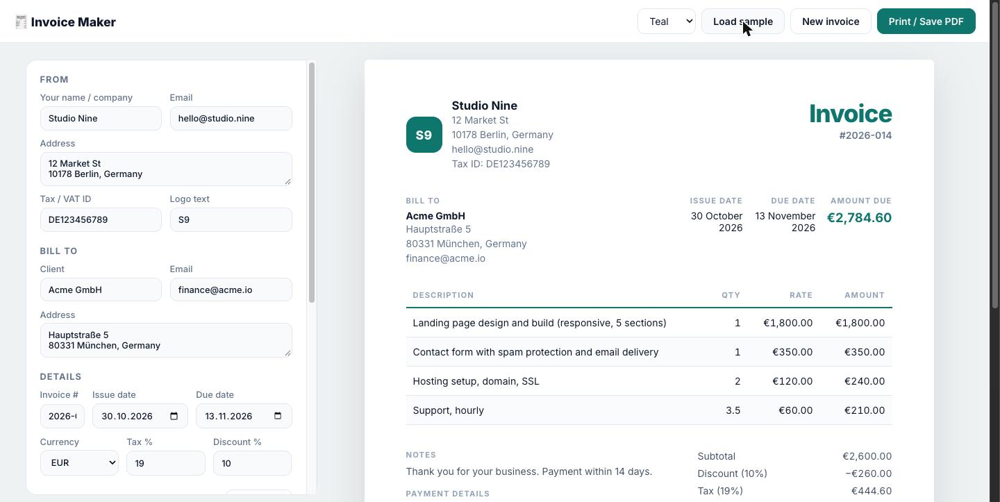

# Invoice Maker

Create a clean invoice in the browser, watch it update as you type, then print it or save as PDF.
Plain HTML, CSS and JavaScript. No account, no server: the draft lives in `localStorage` on your device.



**Live:** https://tigran-ohanyan.github.io/invoice-maker/

## Features

- Side-by-side editor and live A4 preview
- Line items with quantity and rate, subtotal, percentage discount, tax, total
- Six currencies with proper symbols and thousands separators
- Four color themes for the invoice
- "New invoice" keeps your company details and payment info, increments the invoice number and resets the dates
- "Load sample" fills in a realistic example
- Print stylesheet: hides the editor, A4 page size, colors preserved; "Save as PDF" in the print dialog produces the file
- Draft autosaved locally; works offline once loaded

## Structure

```
index.html      editor form, invoice markup, item row template
css/style.css   editor layout, invoice themes, print rules
js/app.js       state, rendering, totals, sample data, persistence
```

## Run locally

Open `index.html` in a browser or serve the folder:

```bash
python -m http.server 8000
```

## License

MIT
